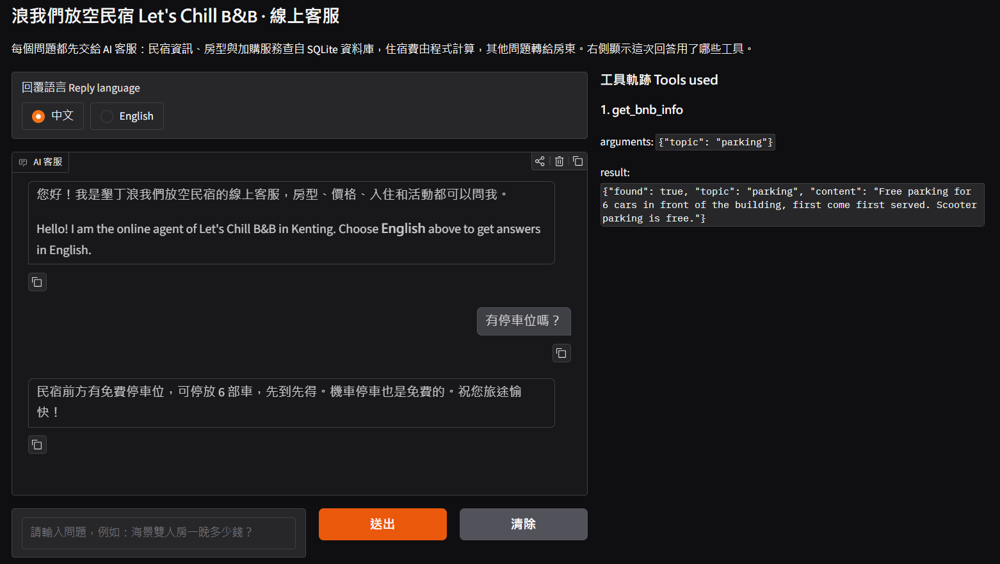
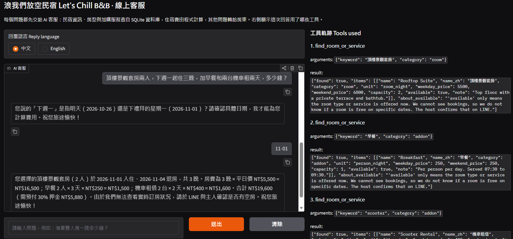
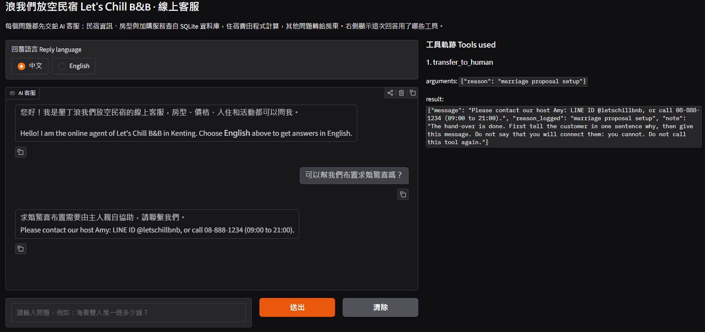

# Let's Chill B&B Agent: Answers Guests' Questions About Rooms, Prices and Check-In

An AI text customer service agent for **Let's Chill B&B (浪我們放空民宿)**, a small made-up B&B by Nanwan Beach in Kenting.
Guests ask about rooms, prices, check-in, add-on activities and house rules, in Chinese or English.
The agent answers from the B&B's own database, works out the price of a stay in code, and hands anything it cannot answer to the host.

> Course homework: Unit G, My AI Customer Service Agent, with a Database and Tools
> Student: F115119122 Chu Yu-Xuan



## Who It Serves and When They Use It

- **Who uses it:** travellers planning a beach holiday in Kenting, often families or groups of friends booking for the first time.
- **When they use it:** in the evening or at night while they plan the trip, when the host is busy or asleep and cannot answer LINE.
- **What problem it solves:** the host answers the same questions every day: check-in time, parking, pets, the price of a weekend stay, and whether breakfast is included. Weekend prices make the total confusing, and a guess from a general chatbot can be wrong.

## What It Can Do

| Function | Example question | Tool it uses |
|---|---|---|
| Tell B&B facts: check-in, parking, pets, cancellation, how to book | "Can I bring my dog?" | `get_bnb_info` |
| Find rooms and add-on services, with prices and capacity | "We are 4 people. Which rooms can we book?" | `find_room_or_service` |
| Work out the price of a stay, night by night, with add-ons | "Ocean View Double Room, 2 people, 2 nights from this Friday?" | `calculate_stay_cost` |
| Hand over to the host | "The room was dirty and I want a refund." | `transfer_to_human` |

## How It Works

Every question goes to the agent first. The agent chooses a tool, the tool reads the database
or calculates in code, and the agent answers only from what the tool returns.
The panel on the right of the chat page shows each tool call, its arguments and its result.

- **Model:** Furen-large (NKUST AI Hub, OpenAI-compatible API)
- **Chat screen:** Gradio. Chinese is the default reply language; a button switches the replies to English.
- **Database (SQLite):** built from the CSV files every time the program starts.

  | Table | CSV file | What it holds | Rows |
  |---|---|---|---|
  | `bnb_info` | `bnb_info.csv` | topics such as booking, check-in, transport, parking, cancellation, breakfast, pets | 14 |
  | `rooms_services` | `rooms_services.csv` | 6 room types and 9 add-on services: English and Chinese name, pricing unit, weekday and weekend price, capacity, available or not | 15 |

- **Tools:**

  | Tool | What it does |
  |---|---|
  | `get_bnb_info(topic)` | reads one topic from `bnb_info`; the topic must be one of the topics in the table |
  | `find_room_or_service(keyword, category, guests)` | finds rooms or add-ons in `rooms_services` by an English or Chinese name, by category, or by number of guests |
  | `calculate_stay_cost(room_name, check_in_date, nights, guests, addons)` | checks every night: Friday and Saturday nights use the weekend price, other nights the weekday price; then adds the add-ons by their unit (per person per day, per person, per item per day, per trip or per set) and returns the total and a 30% deposit |
  | `transfer_to_human(reason)` | gives the host's LINE ID and phone number |

- **Safety in the agent loop:** at most 6 model calls per question; only our own four tools can run (an unknown tool name or bad arguments return an error instead of crashing); today's date is given to the model so that "this Friday" becomes a real date.

## Sample Conversations





## Project Files

```text
lets-chill-bnb-agent/
├── app.py                # the agent: database, tools, agent loop and chat screen
├── bnb_info.csv          # the information table
├── rooms_services.csv    # the records table
├── test_tools.py         # tests the tools without the model (19 checks)
├── test_tool_choice.py   # tool-choice test with the model (15 questions)
├── requirements.txt      # the Python packages to install
├── .env.example          # a sample settings file (no real key)
├── .gitignore            # files git must not upload: .env and *.db
├── images/               # screenshots for this README
└── README.md             # this file
```

## How to Install and Run It

1. Download the project:

   ```bash
   git clone https://github.com/f115119122-cell/lets-chill-bnb-agent.git
   cd lets-chill-bnb-agent
   ```

2. Install the packages (Python 3.10 or newer; Gradio 6):

   ```bash
   pip install -r requirements.txt
   ```

3. Make your settings file. Copy `.env.example` to `.env`, then put your own API key after `API_KEY=`.
   The model must support tool calling.

   ```bash
   copy .env.example .env      # Windows
   cp .env.example .env        # macOS or Linux
   ```

4. Start the agent. It builds the database from the CSV files, then opens the chat page:

   ```bash
   python app.py
   ```

5. Open the link shown in the console, usually <http://127.0.0.1:7860>.

6. Optional tests:

   ```bash
   python test_tools.py         # no API key needed
   python test_tool_choice.py   # calls the model about 40 times
   ```

## Notes

- All names, phone numbers, prices and the LINE ID in the data are **made up** for practice.
- The `.env` file holds the API key. It is **not** in this repository. Make your own from `.env.example`.
- The database has no bookings by date, so the agent never says that a room is free on a certain date.
  It tells the guest to ask the host on LINE.
- Known limit: in the tool-choice test, for "你們有游泳池嗎？" (a facility not in the data) the model sometimes
  says it will transfer the guest but does not call `transfer_to_human`.
